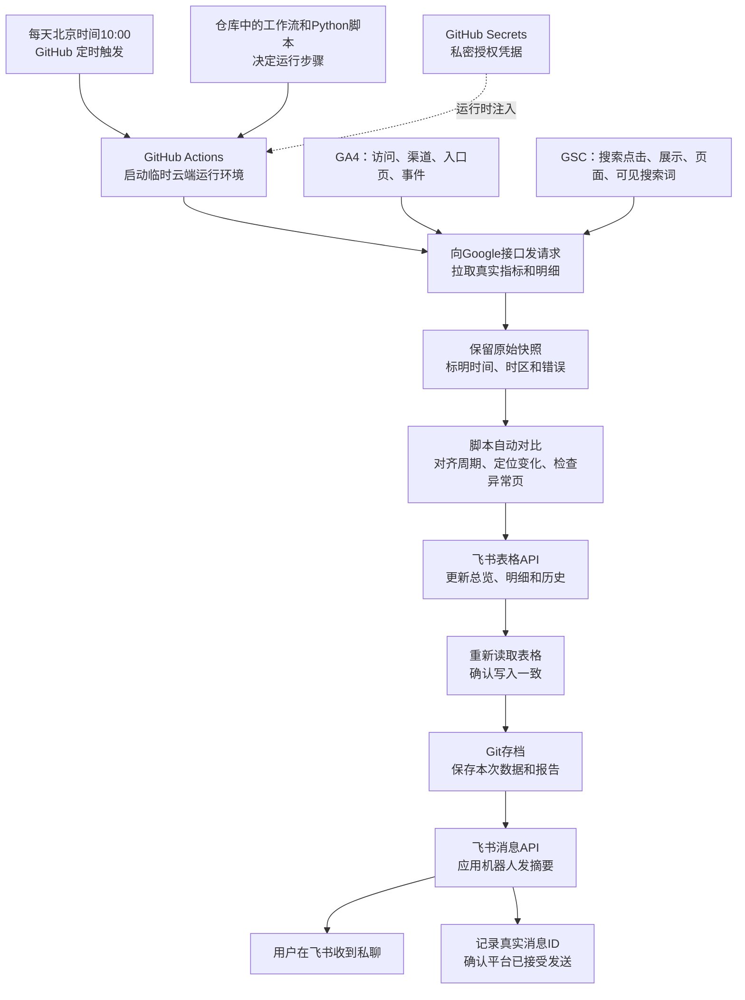

# GA4 / GSC → 自动分析 → 飞书看板与私聊：可复用 SOP

版本：2026-10。适用对象：希望把网站数据变成每日运营结论的个人或小团队。

一套系统分成五件事：Google 提供数据，GitHub 提供定时运行环境，Python 脚本采集和分析，飞书表格保存可追踪的结果，机器人把重点送到人面前。不是 GitHub 自带了飞书报表功能，也不是机器人自己会分析。

## 1. 先看懂整体原理



GitHub Actions 是“每天开机干活的云端电脑”；脚本是“操作流程”；Secrets 是“运行时才交给脚本的钥匙”；API 是各平台允许程序读写的入口。关掉自己的电脑不影响云端任务。

**当前分析是确定性规则，不会每天唤醒 Codex 聊天，也没有每天调用大模型。** 能自动完成已实现的维度拆解和页面检查，不能声称已开展未实现的人工研究、已经找到全部因果或自动修复了网站。

## 2. 最终应该交付什么

| 输出 | 给谁看 | 主要内容 |
| --- | --- | --- |
| 机器人私聊 | 负责人每天看 | 关键数字、具体变化、判断、已完成检查；确需本人操作才单列 |
| 总览看板 | 快速判断业务状态 | 最新完整日、日周变化、关键发现、趋势、接入状态 |
| 分析明细 | 查证结论 | 哪个渠道/入口/词，从多少变到多少、比较哪个周期 |
| 历史明细 | 后续复盘 | 按日期保存 GA4 / GSC 明细，保留来源与抓取时间 |
| 原始JSON与日报 | 维护者排查 | 本次API结果、缺失字段、分析依据、版本记录 |
| 运行日志 | 判断是否真的成功 | 写表回读、存档、实际发送消息ID和错误阶段 |

日报不能只写“流量下降，请检查入口页”。合格结果应像：“首页访问减少，直接访问由122变45；对齐周期后Google访问反而增加，不能把整站下降直接归因排名。已核验首页和票价页可访问。”这是结论的形式示例，不能每天固定沿用这组数值。

## 3. 从零接通：按这个顺序做

### 步骤A：准备数据资产

先确认四个对象：GA4的数字属性ID、GSC资源的准确名称、目标飞书表格、真正接收消息的人或群。GA4 的 `G-XXXX` 是衡量ID，不是Data API使用的数字属性ID；GSC 的域名资源和带协议的网址前缀资源也不能混填。

网站必须已实际部署相应采集代码、GA4和GSC后台已有数据。API接通不会补造此前未采集的访问，AdSense代码存在也不等于收入已接入。

### 步骤B：让程序有权读Google数据

GA4：启用 Google Analytics Data API，创建用于只读取数的服务账号，并在目标GA4属性中授予访问权限。Cloud项目权限与GA4属性权限是两层，只有密钥文件仍可能没有数据访问权。授权范围使用 `analytics.readonly`。见[Google官方快速开始](https://developers.google.com/analytics/devguides/reporting/data/v1/quickstart)。

GSC：本实现使用OAuth只读授权，范围为 `https://www.googleapis.com/auth/webmasters.readonly`。由有权访问目标资源的Google账号完成一次授权，保存配套OAuth客户端配置与refresh token。云端用refresh token换短期access token，随后调用搜索分析接口。更换refresh token时，必须保持与发放它的OAuth客户端匹配。GA4服务账号权限不会自动延伸到GSC。

refresh token不是永久保证。上线前核对Google OAuth应用状态；External + Testing模式下，涉及本SOP这类非基础信息权限的授权通常会有7天refresh token期限，撤销授权等情况也会使它失效。不要等日报失败才意识到需要维护授权。见[Google令牌失效说明](https://developers.google.com/identity/protocols/oauth2#expiration)。

### 步骤C：让程序有权写表和发消息

在飞书开放平台准备应用、启用机器人，并让目标用户处于应用可用范围。表格应用需要对目标表格的实际读写访问；仅申请API权限不等于自动拥有某个文档。可以将“表格应用”和“发消息应用”分开，避免为了发送消息替换现有文档凭据。

私聊使用同一个发消息应用范围下的 `open_id`；群聊可以使用 `chat_id`。手机号登录的用户也有用户ID，不要求一定有邮箱。不能把个人加好友邀请链接当机器人收件地址，也不能把A应用的open_id直接拿到B应用使用。机器人消息权限可使用 `im:message:send_as_bot`，同时核对应用发布状态和可用范围。见[官方发送消息API](https://open.feishu.cn/document/server-docs/im-v1/message/create)。

表格还要区分：整个文件的 `spreadsheet_token` 与文件内部页签的 `sheet_id`。写入范围必须使用真实页签ID，例如 `sheet_id!A1:H20`，不能把“今日重点”这个显示标题直接当ID。

### 步骤D：在GitHub保存运行配置

在目标仓库的 **Settings → Secrets and variables → Actions** 保存下列Secrets。凭据放Secrets，不写进代码、Markdown、截图或聊天。

| 名称 | 内容 | 用途 |
| --- | --- | --- |
| `GOOGLE_SERVICE_ACCOUNT_JSON` | GA4服务账号完整JSON | GA4取数 |
| `GA4_PROPERTY_ID` | GA4数字属性ID | 指定属性 |
| `GOOGLE_OAUTH_CLIENT_JSON` | 与授权匹配的OAuth客户端JSON | GSC换取访问令牌 |
| `GOOGLE_OAUTH_REFRESH_TOKEN` | 对应refresh token本身 | GSC长期自动授权 |
| `GSC_SITE_URL` | 精确GSC资源名称 | 指定搜索资源 |
| `FEISHU_APP_ID` / `FEISHU_APP_SECRET` | 表格应用凭据 | 获取飞书应用访问令牌 |
| `FEISHU_SHEET_TOKEN` | 目标电子表格token | 写入固定表格 |
| `FEISHU_BOT_CONFIG_JSON` | 下述完整JSON | 指定机器人与收件人 |

机器人完整配置的**占位示例**：

```json
{
  "app_id": "<发消息应用ID>",
  "app_secret": "<该应用密钥>",
  "receive_id": "<同一应用识别的收件人ID>",
  "receive_id_type": "open_id"
}
```

Secret内容必须是完整JSON，不能只粘贴App Secret、网页地址、Markdown代码围栏或一段说明。Name和Value是两个输入框。若使用剪贴板传递配置，复制网页地址或Secret名称会覆盖原配置；应直接点击链接，名称手输，Value粘贴。

### 步骤E：部署工作流并设置时间

本项目入口为 `.github/workflows/seo-daily.yml`，运行在GitHub托管的Ubuntu环境，使用Python 3.12并安装 `scripts/requirements-seo.txt`。默认分支上的工作流负责定时；`TZ=Asia/Shanghai`用于报告日期计算，不能据此认为cron也自动换了时区。

本项目用UTC表达北京时间10:00：

```yaml
on:
  schedule:
    - cron: "0 2 * * *"
  workflow_dispatch:
```

保留现有并发互斥，防止同一日报同时写表；仅给日报存档所需的仓库写权限，避免报告机器人提交再次无限触发日报。新项目还需检查Actions是否允许执行和写入仓库。

这是**10:00触发**，不是承诺10:00:00手机一定响。数据采集和回读要时间，GitHub排队也可能延迟。默认分支、公有仓库长期不活跃停用等限制也要纳入巡检。严格到点送达的业务，应另选有相应运行保证的调度方案。见[GitHub官方schedule说明](https://docs.github.com/en/actions/reference/workflows-and-actions/events-that-trigger-workflows#schedule)。

### 步骤F：手动跑通，再验收自然定时

首次配置不要等到第二天：进入 **Actions → SEO daily report → Run workflow**。更新Secret后可以重跑失败任务，不需要为了触发而制造代码改动。命令行GitHub登录不是必需前提；网页保存Secret与手动运行同样可用。

验收顺序：真实API有数据 → 口径正确 → 表格实际写入 → 回读一致 → 原始数据和日报存档 → 飞书返回实际消息ID → 整体任务成功。单元测试里的mock消息ID不算，文件存在不算，表格写入请求返回成功也不能替代回读。

手动成功后，再确认下一次 `schedule` 类型运行自然触发。一次手动成功说明链路可用，不等于已经观察多日稳定投递。

## 4. 每天机器具体做什么

| 阶段 | 实际动作 | 主要接口或产物 |
| --- | --- | --- |
| 启动 | 下载仓库、安装依赖、跑回归测试 | GitHub托管运行环境 |
| 授权 | 读取Secrets，取得短期访问令牌 | Google OAuth / 飞书tenant access token |
| GA4取数 | 读属性时区，取完整日、两周指标、渠道、入口页、事件 | `properties/{id}:runReport` |
| GSC取数 | 先找已完成日期，再取final的日/周/28日及可见明细 | `sites/{site}/searchAnalytics/query` |
| 自行调查 | 比较渠道、来源、入口页、可见词；对齐Google周期；检查下降页 | `diagnostics` 与 `analysis` |
| 写表 | 按真实sheet_id分批写，随后逐批读取比较 | 飞书Sheets API |
| 存档 | 把本次生成文件提交到最新main，竞争则重新整合 | 日期JSON、日报Markdown |
| 私聊 | 构造短卡片、用稳定UUID防重复、发送并检查消息ID | 飞书 `POST /im/v1/messages` |

应用访问令牌证明“哪个应用在请求”；文档权限决定“能不能改这张表”；收件ID决定“消息给谁”。它们不能互相替代。个人好友关系也不等于应用权限。

## 5. 自动分析必须遵守的口径

1. 报告生成时间不等于数据日期。北京时间早上10点时，GA4属性所在时区可能还在前一天；按该属性时区选择完整日，报告里写清楚。
2. GSC只使用final数据，并在推送中显示截至哪天，不能把“API今天拉取”写成“今天实时搜索量”。官方说明final与all含义，且维度接口有返回限制，见[Search Analytics查询说明](https://developers.google.com/webmaster-tools/v1/searchanalytics/query)。
3. GA4与GSC统计周不一致时，额外取同一个周期的Google来源访问作交叉核对；不能拿错位周的整站下降直接判定Google排名下降。
4. 活跃用户不能跨天或跨渠道直接相加；渠道拆解优先比较访问次数。直接访问减少不等于SEO退步，AI渠道增加不等于已证明AI引用。
5. 比较页面时合并规范的路径差异，但“未记录入口页”不能并入首页。GSC未返回的页面/查询词不自动补零；可见词也不代表全部搜索需求。
6. GA4达到明细上限、受阈值影响或GSC达到本地分页上限时，标明缺口，不声称完整归因。本实现每页1000行，最多拉10000条GSC维度记录；即使读到分页尾部，也不意味着突破Google内部数据限制。
7. 无数据、授权失败、前期为零分开处理；不能都写成“0”或“无限增长”。
8. 结论区分观察与原因。先自行调查，列出具体变化和已排除项；仍不能确认原因就保留不确定性与后续由自动任务/Agent承担的调查，不把查表任务推给用户。

## 6. 飞书怎么整理，人才看得懂

电子表格按阅读层级组织，而不是把所有指标塞进一张宽表：

| 层级 | 页签 | 处理方法 |
| --- | --- | --- |
| 第一眼 | 总览看板 | 只呈现最新核心指标、具体发现和趋势，排在第一 |
| 查原因 | 分析明细、今日重点、每日变化 | 展示两期对象、数值、周期、结论和已做检查 |
| 看使用 | 功能使用、接入状态 | 事件次数及接入边界；点击不冒充订单或收入 |
| 留历史 | 日报汇总、维度、国家×渠道、GSC查询词与页面 | 保留历史，支持复盘，不要求每天逐行阅读 |

本实现是在Sheets里做总览页，不是Base原生仪表盘。若以后需要交互筛选、业务关系或负责人协作，可迁移到Base；不必为了有“看板”二字立刻重建整套系统。

写表时先解析页签ID；每批限制大小并回读。飞书有时会把URL字符串转成富文本，比较时同时检查可见文字和链接目标，不能简单当作数据不一致，也不能把错误链接直接忽略。

私聊模板保持短：

```text
核心数字：完整日数据与日/周变化
已查到：首页/来源/词的具体变化
判断：哪些证据支持，哪些尚不能确定
我已处理：已经完成的核对或修复
需要你操作：仅在确实需要本人授权或决策时出现
[查看看板和明细]
```

## 7. 文件对应关系：改哪里最有效

| 文件 | 负责什么 |
| --- | --- |
| `.github/workflows/seo-daily.yml` | 触发时间、运行环境、Secret注入、步骤顺序 |
| `scripts/seo_daily_ci*.sh` | 串起采集、写表、存档及重试 |
| `scripts/seo_fetch_daily.py` | GA4/GSC真实取数，生成原始快照 |
| `scripts/seo_daily_diagnosis.py` | 来源/页面/可见词对比、周期对齐、页面检查 |
| `scripts/seo_daily_observations.py` | 指标变化、诊断结果装配及Markdown日报 |
| `scripts/seo_daily_dashboard.py` | 总览页布局与真实日趋势 |
| `scripts/seo_feishu_daily_sheet.py` | 页签组织和历史表写入 |
| `scripts/seo_feishu_util.py` | 飞书访问令牌、sheet_id、分批写入与回读 |
| `scripts/seo_daily_publish.py` | 基于最新main安全存档，不污染本次采集文件 |
| `scripts/seo_feishu_bot.py` | 配置解析、短卡片、收件人、UUID与消息ID |
| `tests/test_daily_*.py` | 口径、缺失、归因边界、存档竞争和消息校验 |

## 8. 故障时按阶段排查

| 现象 | 先查什么 | 正确处理 |
| --- | --- | --- |
| GA4无权限 | 属性数字ID、服务账号是否加到该属性 | 修正目标权限，不伪造为0 |
| GSC `invalid_grant` | OAuth客户端和refresh token是否配套、授权是否失效 | 更新对应Secret；必要时由本人重新授权 |
| Secret JSON格式无效 | 是否只粘贴了App Secret、网址或围栏 | 用完整JSON替换原Secret，再重跑 |
| 飞书HTTP403 | API权限、应用发布/可用范围、目标文档授权 | 分清应用权限与文档权限 |
| `sheetId not found` | 是否把页签标题当ID | 查询页签元数据，使用真实sheet_id |
| 写表后回读不一致 | 数据真的不同还是URL变富文本 | 校验文字和目标；真实差异必须失败 |
| Git存档冲突 | 是否在原采集区直接pull/rebase | 用临时工作树基于新main发布生成文件，不吞冲突 |
| 机器人发不出 | 应用/用户ID是否属于同一范围、收件可见性 | 核对配套配置，不用加好友链接代替ID |
| 显示成功却没收到 | 是测试mock还是真实消息ID、是否发错对象 | 逐层确认；平台接受不代表用户已读 |
| 今天没运行记录 | workflow状态、默认分支、时区、排队及停用 | 区分没触发、正在排队、运行失败，按需手动补跑 |

失败时保留原始数据和失败状态，不用旧快照冒充本轮采集，也不将某个步骤成功当成整条链路成功。当前外层最多两轮；消息UUID防止同一版本同一天因重试重复发送。若需要更正已发送日报，应显式更新消息或使用有版本边界的更正推送，不能每次采集都随机生成UUID。

## 9. 复制到另一个项目：最小迁移清单

- 使用自己的仓库与默认分支，复制这一组工作流、脚本、依赖及测试，不复制任何人的凭据、收件人ID或原始业务数据。
- 重新配置自己的Google属性/资源、飞书应用/表格/收件人和Secrets。
- 检查脚本里站点域名、页面目录、AdSense发布商、事件名、品牌文案、UUID前缀和默认属性ID；本仓目前仍有YakuBus专用检测，不能只换Secret就声称完全通用。
- 保留统一的原始快照、诊断结果与表格结构，再调整最有用的业务指标；不要先加几十个没人看的字段。
- 先手动验收一次真实投递，再确认下一次自然定时；将运行链接、数据日期和消息ID留档。
- 若数据涉及企业经营隐私，选择适当的私有仓库或私有存储，而不是照搬本案例的公开指标存档方式。

## 10. 后续值得补的能力（建议，未因本文而自动上线）

**优先补业务转化。** 分销订单/佣金、AdSense收入需要各自后台真实授权。先明确平台能否提供API或可核验导出，再接入，不从GA4点击推算收入。

**增加投递健康巡检。** 区分“今天没触发”和“触发后失败”；长期任务需观察到下一次真实schedule运行，授权过期和计划停用也要能被发现。异常通知应说具体失败阶段，不只发一句日报失败。

**建立行动与效果闭环。** 把发现、执行、观察窗口放在同一条记录里；例如某入口修复后比较同星期、相近完整周期，不凭一天涨跌宣布SEO有效。当前的记录与证据可承接这个闭环，但不等于已自动执行所有营销改动。

**需要更开放的调查时再加AI。** 可以增加受控的模型分析步骤，读取经过整理的真实指标与检查结果，要求每项判断附对象和证据；取数、计算和送达仍交给确定性程序。模型不得改数字、编原因或把建议写成已执行；无证据时明确未知。是否把业务数据发送到模型服务，需要另行选择范围和授权，不能默认已接入。

## 11. 本项目实施状态与验收

此前整条云端链路已于2026-10-27成功验收：run40363044223第2次运行，真实消息ID由飞书返回；这证明采集、写表、存档和私聊可连通。10:00时间调整与新增自动诊断以本轮最新提交及其云端运行记录为准，不把旧版本验收当新版本验证。

参考入口：[运行手册](RUNBOOK.md)、[通知配置](NOTIFICATIONS.md)、[Google配置](GOOGLE_SETUP.md)、[飞书配置](FEISHU_SETUP.md)。
